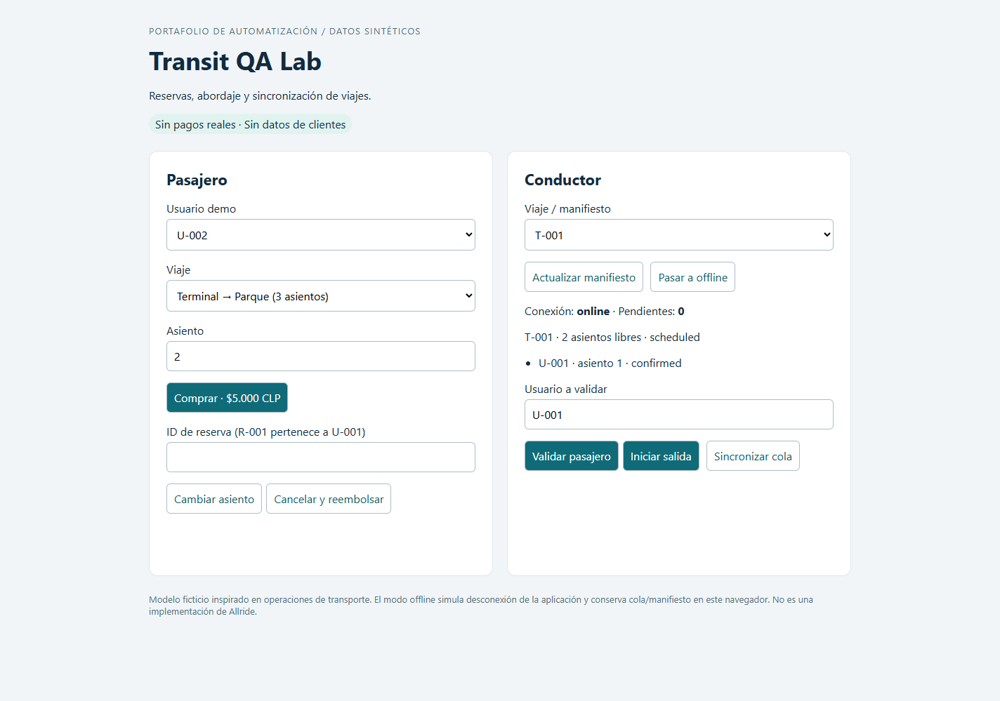
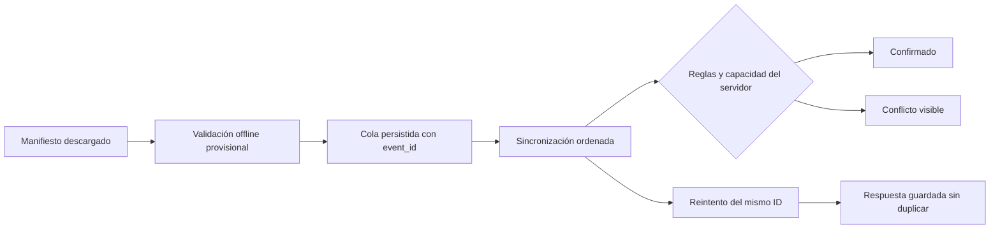

# Transit QA Lab · Portafolio QA Automation

[](https://github.com/Nico2795/Portafolio-QA-/actions/workflows/qa.yml)

Proyecto demostrativo de QA para operaciones de transporte: **compra de pasajes, asignación de asientos, edición, cancelación, reembolsos y validación/salida del conductor online y offline**.

Robot Framework + Selenium + pruebas REST + SQLite + GitHub Actions. Incluye 42 casos automatizados: 34 de API/integración y 8 E2E en Chrome, con escenarios positivos, negativos, concurrencia y sincronización.

Todos los usuarios, viajes, credenciales y montos son ficticios. El proyecto está inspirado en problemas del dominio de transporte; no contiene código, datos, reglas internas ni integraciones de Allride u otro empleador. Las reglas concretas de esta demo se explicitan para que puedan discutirse en una entrevista.



## Recorrido recomendado para quien evalúa

1. Revisar [estrategia, riesgos y trazabilidad](docs/test-strategy.md).
2. Leer el caso crítico [DRV-002](tests/api/driver.robot): usuario sin reserva + viaje lleno → HTTP 409, sin crear reserva ni abordar.
3. Revisar [sincronización](tests/api/synchronization.robot): repetición de eventos, manifiesto desactualizado y conflictos.
4. Ejecutar las pruebas y abrir `results/report.html`.
5. Consultar [el pipeline](.github/workflows/qa.yml), [la validación local](docs/validation.md), [el defecto controlado](docs/defect-example.md) y la [guía de demostración](docs/demo-guide.md).

## Ejecutar en Windows

Requisitos: Python 3.12, Google Chrome y acceso a Internet para instalar dependencias y resolver ChromeDriver mediante Selenium Manager en la primera ejecución.

```powershell
git clone https://github.com/Nico2795/Portafolio-QA-.git
cd Portafolio-QA-
python -m venv .venv
.\.venv\Scripts\python.exe -m pip install -r requirements.txt
.\.venv\Scripts\python.exe scripts/run_tests.py
Start-Process results/report.html
```

Linux/macOS: usar `.venv/bin/python` en lugar de `.\.venv\Scripts\python.exe`. No es necesario activar el entorno virtual. En Linux se necesita Chrome y sus dependencias de sistema; los runners `ubuntu-24.04` de GitHub incluyen Chrome.

```bash
python scripts/run_tests.py --suite api
python scripts/run_tests.py --suite ui
python scripts/run_tests.py --include smoke
python scripts/check_detection.py
python scripts/performance.py --requests 100 --workers 4 --p95-ms 1000
```

Los comandos anteriores asumen que `python` apunta al entorno del proyecto. El runner inicia un servidor en un puerto libre y una base temporal por suite; reinicia los datos antes de cada caso y libera los recursos al finalizar. No hay que levantar servicios externos ni usar cuentas reales.

Para explorar la demo manualmente:

```bash
python -m demo.server --db manual-demo.db
```

Abrir [la demo local](http://127.0.0.1:8000). El archivo conserva las operaciones entre ejecuciones. Para empezar otro escenario limpio, usar otro nombre con `--db`; limpiar el almacenamiento del navegador también elimina la cola offline local.

## Dos escenarios clave

**Validación sin cupo:** en `T-FULL`, `U-002` no tiene reserva. La validación se rechaza tanto online como en el manifiesto offline; tampoco puede saltarse la regla enviando el evento directamente a la API de sincronización. Un pasajero que sí tiene reserva puede abordar ese viaje lleno.

**Conflicto offline:** el conductor tiene un manifiesto con cupos y registra un pasajero sin reserva mientras está offline. Otros pasajeros ocupan esos cupos en el servidor. Al sincronizar, la operación local se rechaza con `no_seats` y se muestra como conflicto. El estado del servidor prevalece y no se supera la capacidad.



## Qué demuestra

| Habilidad | Evidencia |
|---|---|
| Automatización web | SeleniumLibrary, selectores `data-testid`, esperas por condición y captura de pantalla ante fallo |
| API e integración | RequestsLibrary, contrato JSON Schema y comprobación independiente en SQLite |
| Casos negativos | Asientos ocupados, límites/tipos inválidos, permisos, reservas abordadas y viaje iniciado |
| Concurrencia | Dos compradores compiten por el mismo asiento; solo uno puede obtenerlo |
| Offline/sync | Cola en `localStorage`, persistencia tras recarga, reintentos, orden y resolución de conflictos |
| Análisis de fallos | Defecto inyectado en memoria que debe hacer fallar exactamente el caso de viaje lleno |
| Rendimiento | Carga breve del manifiesto con validación funcional, p95 y tasa de errores |
| Trabajo con negocio | Reglas, preguntas al Client Manager, riesgos, matriz y checklist de entrega |

## CI/CD y evidencias

| Trigger | Ejecución |
|---|---|
| Push a `main`, `master`, `codex/**` | API y UI en jobs separados + verificación de detección de defectos |
| Pull request hacia `main`/`master` | Las mismas comprobaciones |
| Ejecución manual (`workflow_dispatch`) | Todas las anteriores + rendimiento |
| Lunes 09:17 UTC (`schedule`) | Todas las anteriores + rendimiento |

El cron usa UTC y corre sobre la rama por defecto. La disponibilidad y política de inactividad de GitHub pueden afectar ejecuciones programadas. No se usan secretos ni entornos externos.

Los reportes se suben con `always()` aunque fallen las pruebas. Si las comprobaciones requeridas pasan, el job de entrega genera un ZIP del código validado. Esto demuestra **entrega continua de un artefacto**, sin desplegar infraestructura pública. Para impedir merges con fallos hay que habilitar protección de rama y exigir los checks en GitHub; el YAML por sí solo no configura esa protección.

Evidencias locales: `output.xml`, `report.html`, `log.html`, `junit.xml` y screenshots de fallos en `results/`. En Actions se descargan desde **Artifacts**, se descomprimen y se abre `report.html`. Retención: 14 días. Los reportes y las bases temporales no se versionan.

## Estructura

```text
demo/            Sistema bajo prueba, interfaz y datos ficticios
tests/api/       Reservas, conductor y sincronización
tests/ui/        Flujos E2E en Chrome
resources/       Keywords de negocio reutilizables
libraries/       Fixtures, servidor aislado y aserciones SQL/contrato
contracts/       JSON Schema de respuesta de compra
scripts/         Runner, detección de defecto, rendimiento y empaquetado
docs/            Estrategia, contrato API, defecto y guía de entrevista
.github/         Workflow y plantilla de defectos
```

## Alcance y límites

El modo offline simula la desconexión funcional de la app: usa manifiesto y cola locales sin llamar a la API para validar o salir. La página debe haberse cargado previamente; no hay service worker para abrirla desde cero sin red. El E2E también simula un fallo de transporte al sincronizar para comprobar que no se pierde la cola. No sustituye pruebas móviles en dispositivos ni una pérdida física de conectividad.

Los pasajes y reembolsos son movimientos en SQLite, sin procesador de pagos. Los tokens fijos identifican usuarios/roles de prueba; no implementan autenticación productiva, expiración o seguridad del dispositivo. Solo hay un conductor y dos viajes; no se modelan fechas, zonas horarias, transferencias entre rutas ni múltiples dispositivos offline.

La prueba de rendimiento usa 100 lecturas locales y 4 workers por defecto, con un umbral ilustrativo p95 ≤ 1000 ms y cero errores. No permite inferir capacidad productiva ni equivale a estrés/soak testing. Las dependencias directas están fijadas; las transitivas se resuelven durante la instalación.

## Referencias

- [Aviso de Ingeniero/a QA Automation, LeytonMedia](https://www.getonbrd.com/empleos/sysadmin-devops-qa/ingeniero-a-qa-automation-leytonmedia-santiago), ID 64629: alcance contrastado con el texto facilitado por el postulante.
- [Sintaxis oficial de GitHub Actions](https://docs.github.com/en/actions/reference/workflows-and-actions/workflow-syntax).
- [Robot Framework](https://robotframework.org/) y [SeleniumLibrary](https://robotframework.org/SeleniumLibrary/).

**English summary:** A self-contained transport QA portfolio covering ticket booking, seat allocation, refunds, driver boarding and offline event reconciliation. Tests combine Robot Framework, Selenium, REST assertions and SQL invariants. GitHub Actions validates changes and delivers a source artifact after quality gates pass.
